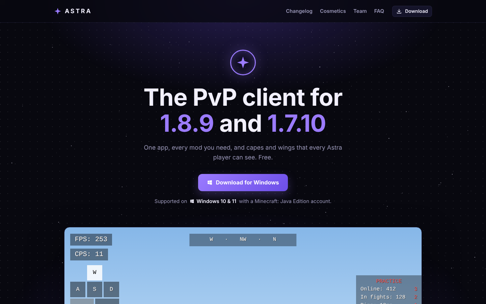
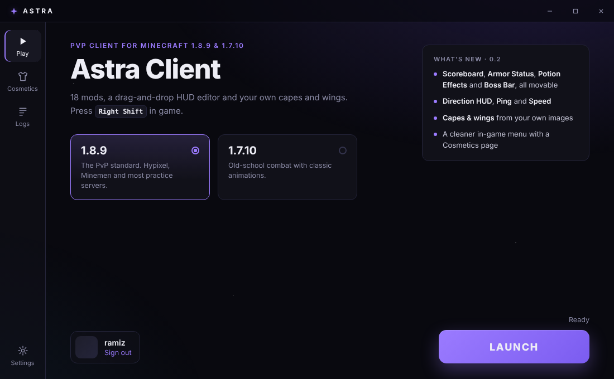
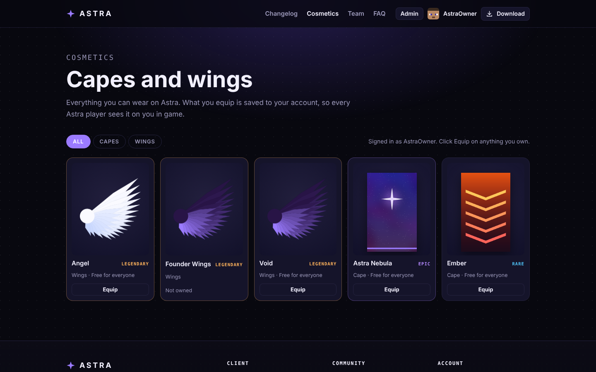
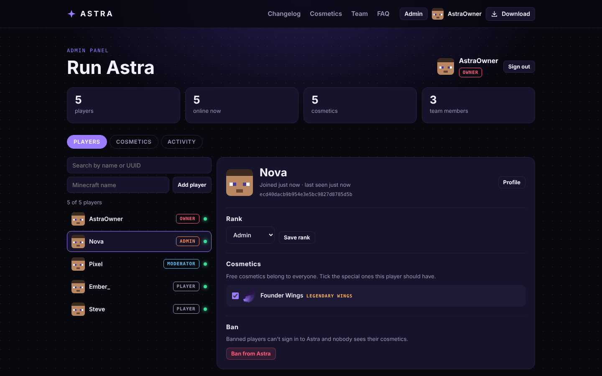

<div align="center">

# ✦ Astra Client

**The Minecraft client built for PvP.**
One app for Minecraft 1.8.9 and 1.7.10. Sign in, press Launch, and your HUD, zoom, toggle sprint and cosmetics are already there, with capes, wings and rank tags that every Astra player can see.




</div>

---

## Contents

- [Features](#features)
- [Screenshots](#screenshots)
- [For players](#for-players)
- [Cosmetics](#cosmetics)
- [Run an Astra server](#run-an-astra-server)
- [For developers](#for-developers)
- [Project structure](#project-structure)
- [Roadmap](#roadmap)
- [License](#license)

## Features

**One app.** The Astra Launcher handles Microsoft sign-in and downloads Java 8, Minecraft and the mod loader for you. It keeps everything in its own folder, so your normal `.minecraft` is never touched.

**Everything in one menu.** Press **Right Shift** in game. Every feature is a card with a live preview: click to turn it on, open **Options** to tune colors, size, backgrounds and keybinds.

**A HUD you arrange.** The HUD editor lets you drag anything anywhere. It snaps to the screen edges and center, scroll resizes, and layouts are saved per version.

**Capes and wings from your own art.** Any picture becomes a cape, and a single wing becomes a flapping pair.

### Built-in features

| Feature | What it does | Default |
|---|---|:---:|
| FPS / CPS | Frames and clicks per second | On |
| Keystrokes | WASD, mouse buttons with CPS and space, with press fades | On |
| Scoreboard | Movable sidebar; hide the red numbers, change the opacity | On |
| Armor Status | Armor and held item with durability (value or percent) | On |
| Potion Effects | Active effects with icons and time left; blinks when ending | On |
| Boss Bar | Move or resize the wither and dragon bar | On |
| Toggle Sprint | Tap Left Ctrl to keep sprinting | On |
| Zoom | Hold **C**; smooth, lowers mouse sensitivity while zoomed | On |
| Direction HUD | Compass strip with your heading in degrees | Off |
| Coordinates | X, Y, Z and facing | Off |
| Ping / Speed | Latency to the server; blocks per second | Off |
| Clock / Memory | Local time; RAM use | Off |
| Fullbright | Full brightness; restores your gamma when turned off | Off |

Astra only includes visual and quality-of-life features. There's no reach, autoclicker or x-ray, and there never will be.

## Screenshots

| Launcher | Cosmetics catalog |
|---|---|
|  |  |

**Admin panel:** players, ranks, gifts and bans, cosmetic uploads and an activity log.



## For players

**Requirements:** Windows 10 or 11 (64-bit) and a Microsoft account that owns Minecraft: Java Edition.

1. Download the installer from [Releases](../../releases) and run it.
2. Open **Astra Launcher** and sign in with Microsoft.
3. Pick **1.8.9** or **1.7.10** and press **Launch**. The first launch downloads the game, which takes a few minutes.
4. In game, press **Right Shift** to open the Astra menu.

| Where | What's there |
|---|---|
| `%APPDATA%\.astra\instances\<version>` | Worlds, options, screenshots and Astra settings (`config/astra.json`) for each version |
| `%APPDATA%\Astra Launcher\logs` | Launcher and game logs (also in the Logs tab) |

Resource packs, screenshots, the server list and your settings are shared with your normal `.minecraft` folder (turn this off in **Settings → Share with .minecraft**). If `.minecraft` holds settings from a newer Minecraft version, only settings both versions understand (FOV, brightness, render distance, volume, resource packs and so on) are shared, so the official game's keybinds are never touched.

Sign-in uses Microsoft's own page. Astra stores only a refresh token, encrypted with Windows' data protection (DPAPI), never your password.

## Cosmetics

Cosmetics live on the **Astra server**, so everyone sees them. When you launch, the app signs you in to the server and the game looks up every player around you, so any Astra player's cape, wings and rank tag (like **[Owner]** or **[Moderator]**) show for you, and yours show for them.

- **Wear something:** in the app's **Cosmetics** tab, in game with **Right Shift → Cosmetics**, or on the website's Cosmetics page. Whatever you pick shows for everyone within a few seconds.
- **Get more:** free cosmetics belong to everyone. Staff can give anyone special ones from the admin panel.
- **Options in game:** show or hide capes, wings, other players' cosmetics and rank tags; wing size and flap speed.

Players on other clients see the normal game. Cosmetics are matched by Minecraft account UUID, so they show on online-mode servers (Hypixel and the like), not on cracked/offline-mode servers.

### Making new cosmetics

Staff upload images in the admin panel's **Cosmetics** tab. The client turns them into textures:

- **Capes:** any picture works. Astra crops it to the cape's 10:16 shape and wraps it onto the cape. A standard 64×32 cape template (or HD 128×64, 256×128 and so on) is used as-is.
- **Wings:** one wing with its root on the **left** and its tip on the **right**, or a pair side by side. A plain background like white is removed automatically, but a transparent PNG gives the cleanest edges.

Prompts that work well in an AI image tool:

> **Cape:** *A vertical banner design, 10:16 portrait, [your theme], flat bold colors, no text, fills the whole image.*
>
> **Wing:** *A single [angel/dragon/feather] wing, side view, attached on the left and extending right, centered, on a plain white background, no shadow.*

Keep details big: a cape is only 10×16 Minecraft pixels on screen.

## Run an Astra server

The server in [`server/`](server) is the website, the API the client and app talk to, and a small JSON database, all in one Node.js app with no dependencies.

```bash
cd server
cp config.example.json config.json   # then put your Minecraft name in "owners"
npm start                            # http://localhost:8787
npm test                             # API tests
```

1. Start the server, then open the Astra app, go to **Settings → Astra server** and enter its address (the default is `http://localhost:8787`).
2. Launch once. You're signed in with your Minecraft account and, because your name is in `owners`, you're the **Owner**.
3. Click **Admin** in the app's sidebar. The admin panel opens in your browser, already signed in.

| Rank | Can |
|---|---|
| **Owner** | Everything, including making other Owners |
| **Admin** | Everything below, plus upload, edit and delete cosmetics and change ranks below Admin |
| **Developer** | Everything below, plus give and take cosmetics |
| **Moderator** | Open the admin panel, ban and unban players |
| **Media** | A tag in game and a spot on the Team page |
| **Player** | Wear free cosmetics and ones they're given |

Every staff action is recorded in the admin panel's **Activity** tab. Ranks and permissions are defined in [`server/src/services/Ranks.js`](server/src/services/Ranks.js).

**How sign-in works:** the Astra server never sees a Microsoft password or token. It works like joining a Minecraft server: the server hands out a one-time challenge, the app tells Mojang's session server it's joining that challenge, and the Astra server asks Mojang to confirm. The website has no passwords at all; the app opens it with a one-time sign-in link.

**Config** (`config.json`, or environment variables):

| Key | Env | Meaning |
|---|---|---|
| `port` | `PORT` | Port to listen on (default 8787) |
| `publicUrl` | `ASTRA_PUBLIC_URL` | The address players use, e.g. `https://astra.example.com` |
| `owners` | `ASTRA_OWNERS` | Minecraft names that are always Owner (comma-separated in the env var) |
| `downloadUrl` | `ASTRA_DOWNLOAD_URL` | Where the website's Download buttons point (e.g. a GitHub Release) |
| `dataDir` | `ASTRA_DATA_DIR` | Where players, cosmetics and images are stored (default `data/`) |
| `devAuth` | `ASTRA_DEV_AUTH` | **Testing only:** skips the Mojang check, so anyone can claim any name |

To let friends join, host it somewhere with HTTPS (a small VPS behind Caddy or nginx, Railway, Fly.io and so on), set `publicUrl`, and have everyone put that address in the app's settings. Back up the `data/` folder.

## For developers

### Prerequisites

| Tool | Version | Used for |
|---|---|---|
| JDK | 21 | Running Gradle and Loom (the client itself targets Java 8) |
| Node.js | 20+ | The Electron launcher |
| IntelliJ IDEA | any recent | Recommended for the Java side |

### Build the client

```bash
git clone https://github.com/LoyaltyVal/Astra---Minecraft-Client.git
cd Astra---Minecraft-Client
./gradlew build                        # jars: versions/<mc>/build/libs/astra-<version>+<mc>.jar
./gradlew :versions:1.8.9:runClient    # dev client without the launcher
```

In IntelliJ, open the folder and set **Settings → Build Tools → Gradle → Gradle JVM** to **Java 21**.

### Run the launcher

```bash
cd launcher
npm install
npm start          # uses the newest jars from ../versions/<mc>/build/libs
npm run dist       # builds launcher/dist/Astra Launcher Setup <version>.exe
```

During development the loop is `./gradlew build`, then **Launch**: the launcher copies the newest jar into the game every time. `npm run dist` bundles the jars into the installer.

### Add a feature

1. Create a class in `common/src/main/java/dev/astra/client/module/impl/`. Extend `TextHudModule` for a one-line readout, `HudModule` for custom drawing, or `Module` for a mechanic.
2. Add settings with `setting(new BooleanSetting(...))`, `NumberSetting`, `ColorSetting`, `KeySetting` or `ModeSetting`. They appear in the menu and save automatically.
3. Register it in `ModuleManager.registerDefaults()`.

```java
public final class SessionTimeModule extends TextHudModule {
    private final long started = System.currentTimeMillis();

    public SessionTimeModule() {
        super("Session", "How long you've been playing.", false, 4, 120);
    }

    @Override
    protected String getText() {
        long s = (System.currentTimeMillis() - started) / 1000;
        return String.format("Session: %d:%02d", s / 60, s % 60);
    }
}
```

### How versions work

Everything version-independent lives in `common/` and talks to Minecraft only through the `Platform` interface. Each `versions/<mc>/` folder holds one `PlatformImpl`, a screen wrapper and a few mixins, and those are the only files that use Minecraft names. Every name was checked against the Legacy Yarn build 604 jars for both versions. If a mappings update renames something, run `./gradlew :versions:<mc>:genSources` and look it up.

To add a Minecraft version, copy `versions/1.8.9`, change its `gradle.properties`, fix any renamed names, and add it to `settings.gradle`.

## Project structure

```
common/                  Version-independent code: features, HUD, menus, cosmetics, config
versions/1.8.9/          PlatformImpl, AstraScreen, WingsFeature and mixins for 1.8.9
versions/1.7.10/         The same for 1.7.10
gradle/version.gradle    Shared build logic for every version
launcher/src/main/       Electron main process: sign-in, Astra account, downloads, launching
launcher/src/renderer/   Launcher UI
server/src/              Astra server: HTTP router, JSON store, services (auth, players, ranks, cosmetics, audit), routes
server/public/           Website: home, cosmetics, team, player profiles, admin panel (one JS class per page)
server/seed/             Starter capes and wings added on first run
server/test/             API tests (node --test)
docs/images/             Screenshots for this README
```

## Roadmap

- [x] HUD features, mod menu and HUD editor
- [x] Astra Launcher with Microsoft sign-in and automatic setup
- [x] Capes and wings from your own images
- [x] Astra server: cosmetics everyone sees, ranks, website and admin panel
- [ ] Launcher auto-update (electron-updater with GitHub Releases)
- [ ] Code-signed installer, so Windows SmartScreen doesn't warn
- [ ] macOS and Linux builds

## License

All rights reserved. Astra has no open-source license yet, so you may read the code but not redistribute it or publish modified versions without permission.

Astra is not an official Minecraft product and is not approved by or associated with Mojang or Microsoft.
