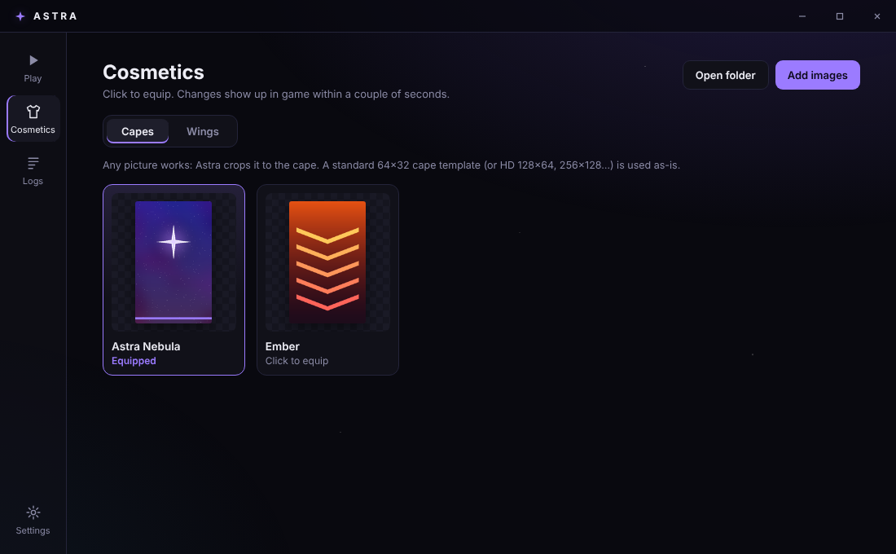

✦ Astra Client

The Minecraft client built for PvP. One app for Minecraft 1.8.9 and 1.7.10. Sign in, press Launch, and your HUD, zoom, toggle sprint and cosmetics are already there.

Show Image Show Image Show Image Show Image Show Image Show Image

 

Contents
Features
Screenshots
For players
Cosmetics
For developers
Project structure
Roadmap
License
Features

One app. The Astra Launcher handles Microsoft sign-in and downloads Java 8, Minecraft and the mod loader for you. It keeps everything in its own folder, so your normal .minecraft is never touched.

Everything in one menu. Press Right Shift in game. Every feature is a card with a live preview: click to turn it on, open Options to tune colors, size, backgrounds and keybinds.

A HUD you arrange. The HUD editor lets you drag anything anywhere. It snaps to the screen edges and center, scroll resizes, and layouts are saved per version.

Capes and wings from your own art. Any picture becomes a cape, and a single wing becomes a flapping pair.

Built-in features
Feature	What it does	Default
FPS / CPS	Frames and clicks per second	On
Keystrokes	WASD, mouse buttons with CPS and space, with press fades	On
Scoreboard	Movable sidebar; hide the red numbers, change the opacity	On
Armor Status	Armor and held item with durability (value or percent)	On
Potion Effects	Active effects with icons and time left; blinks when ending	On
Boss Bar	Move or resize the wither and dragon bar	On
Toggle Sprint	Tap Left Ctrl to keep sprinting	On
Zoom	Hold C; smooth, lowers mouse sensitivity while zoomed	On
Direction HUD	Compass strip with your heading in degrees	Off
Coordinates	X, Y, Z and facing	Off
Ping / Speed	Latency to the server; blocks per second	Off
Clock / Memory	Local time; RAM use	Off
Fullbright	Full brightness; restores your gamma when turned off	Off

Astra only includes visual and quality-of-life features. There's no reach, autoclicker or x-ray, and there never will be.

Screenshots
Launcher	Cosmetics
	
For players

Requirements: Windows 10 or 11 (64-bit) and a Microsoft account that owns Minecraft: Java Edition.

Download the installer from Releases and run it.
Open Astra Launcher and sign in with Microsoft.
Pick 1.8.9 or 1.7.10 and press Launch. The first launch downloads the game, which takes a few minutes.
In game, press Right Shift to open the Astra menu.
Where	What's there
%APPDATA%\.astra\instances\<version>	Worlds, options, screenshots and Astra settings (config/astra.json) for each version
%APPDATA%\.astra\cosmetics	Your capes and wings
%APPDATA%\Astra Launcher\logs	Launcher and game logs (also in the Logs tab)

Sign-in uses Microsoft's own page. Astra stores only a refresh token, encrypted with Windows' data protection (DPAPI), never your password.

Cosmetics

Add images from the launcher's Cosmetics → Add images, or drop them into %APPDATA%\.astra\cosmetics\capes or ...\wings. Click one to equip it, in the launcher or in game; the two stay in sync, and changes show up in game within a couple of seconds.

Capes: any picture works. Astra crops it to the cape's 10:16 shape and wraps it onto the cape. A standard 64×32 cape template (or HD 128×64, 256×128 and so on) is used as-is.
Wings: one wing with its root on the left and its tip on the right, or a pair side by side. A plain background like white is removed automatically, but a transparent PNG gives the cleanest edges. Wing size, flap speed and orientation are in Cosmetics → Options in game.

Prompts that work well in an AI image tool:

Cape: A vertical banner design, 10:16 portrait, [your theme], flat bold colors, no text, fills the whole image.

Wing: A single [angel/dragon/feather] wing, side view, attached on the left and extending right, centered, on a plain white background, no shadow.

Keep details big: a cape is only 10×16 Minecraft pixels on screen.

[!NOTE] For now, cosmetics show only on your own player, in third person (F5) and in your inventory. Showing them to other Astra players needs a cosmetics server. CosmeticsManager is the single place to plug one in.

For developers
Prerequisites
Tool	Version	Used for
JDK	21	Running Gradle and Loom (the client itself targets Java 8)
Node.js	20+	The Electron launcher
IntelliJ IDEA	any recent	Recommended for the Java side
Build the client
bash
git clone https://github.com/LoyaltyVal/Astra---Minecraft-Client.git
cd Astra---Minecraft-Client
./gradlew build                        # jars: versions/<mc>/build/libs/astra-<version>+<mc>.jar
./gradlew :versions:1.8.9:runClient    # dev client without the launcher

In IntelliJ, open the folder and set Settings → Build Tools → Gradle → Gradle JVM to Java 21.

Run the launcher
bash
cd launcher
npm install
npm start          # uses the newest jars from ../versions/<mc>/build/libs
npm run dist       # builds launcher/dist/Astra Launcher Setup <version>.exe

During development the loop is ./gradlew build, then Launch: the launcher copies the newest jar into the game every time. npm run dist bundles the jars and the starter cosmetics into the installer.

Add a feature
Create a class in common/src/main/java/dev/astra/client/module/impl/. Extend TextHudModule for a one-line readout, HudModule for custom drawing, or Module for a mechanic.
Add settings with setting(new BooleanSetting(...)), NumberSetting, ColorSetting, KeySetting or ModeSetting. They appear in the menu and save automatically.
Register it in ModuleManager.registerDefaults().
java
public final class SessionTimeModule extends TextHudModule {
    private final long started = System.currentTimeMillis();

    public SessionTimeModule() {
        super("Session", "How long you've been playing.", false, 4, 120);
    }

    @Override
    protected String getText() {
        long s = (System.currentTimeMillis() - started) / 1000;
        return String.format("Session: %d:%02d", s / 60, s % 60);
    }
}
How versions work

Everything version-independent lives in common/ and talks to Minecraft only through the Platform interface. Each versions/<mc>/ folder holds one PlatformImpl, a screen wrapper and a few mixins, and those are the only files that use Minecraft names. Every name was checked against the Legacy Yarn build 604 jars for both versions. If a mappings update renames something, run ./gradlew :versions:<mc>:genSources and look it up.

To add a Minecraft version, copy versions/1.8.9, change its gradle.properties, fix any renamed names, and add it to settings.gradle.

Project structure
common/                  Version-independent code: features, HUD, menus, cosmetics, config
versions/1.8.9/          PlatformImpl, AstraScreen, WingsFeature and mixins for 1.8.9
versions/1.7.10/         The same for 1.7.10
gradle/version.gradle    Shared build logic for every version
launcher/src/main/       Electron main process: sign-in, downloads, launching, cosmetics
launcher/src/renderer/   Launcher UI
launcher/resources/      Starter capes and wings bundled with the installer
website/                 The Astra website (a single index.html)
docs/images/             Screenshots for this README
Roadmap
 HUD features, mod menu and HUD editor
 Astra Launcher with Microsoft sign-in and automatic setup
 Capes and wings from your own images
 Cosmetics server, so other Astra players can see your cosmetics
 Launcher auto-update (electron-updater with GitHub Releases)
 Code-signed installer, so Windows SmartScreen doesn't warn
 macOS and Linux builds
License

All rights reserved. Astra has no open-source license yet, so you may read the code but not redistribute it or publish modified versions without permission.

Astra is not an official Minecraft product and is not approved by or associated with Mojang or Microsoft.
